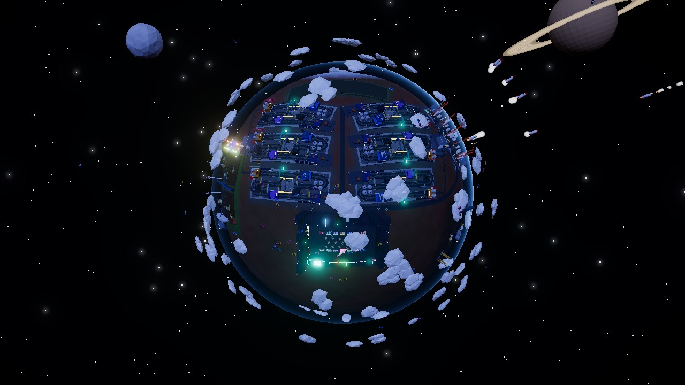
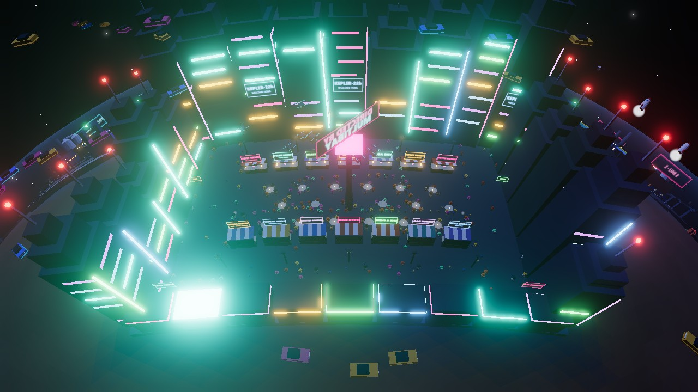
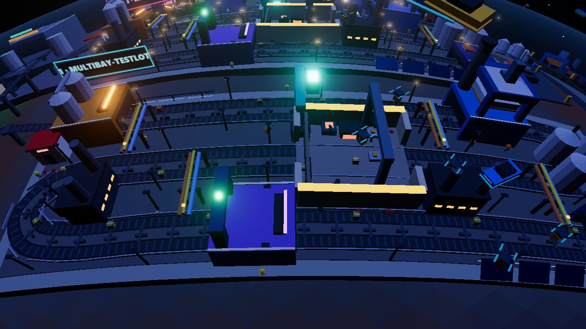
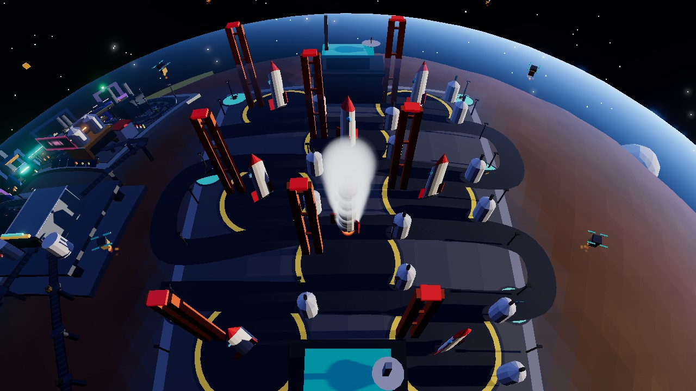
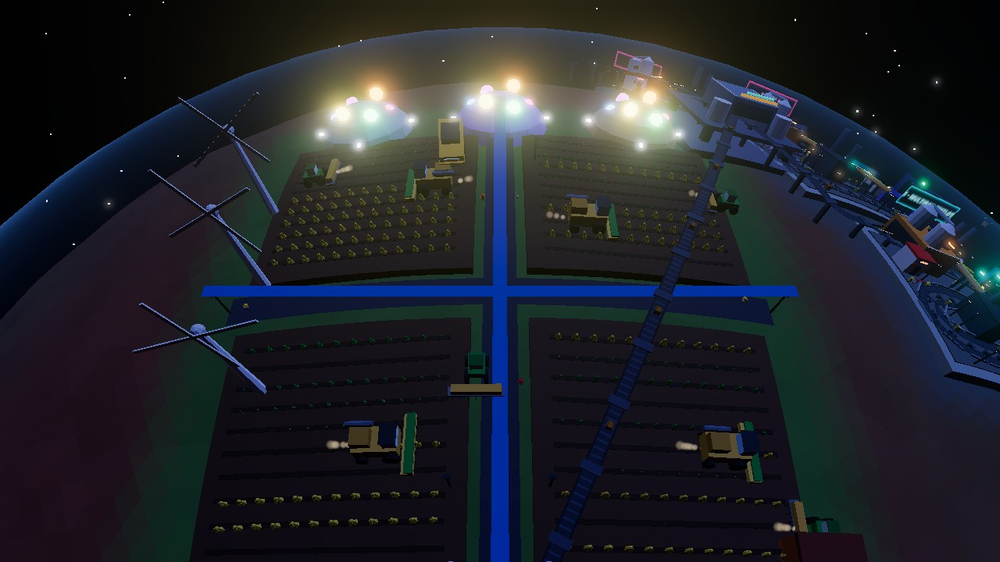
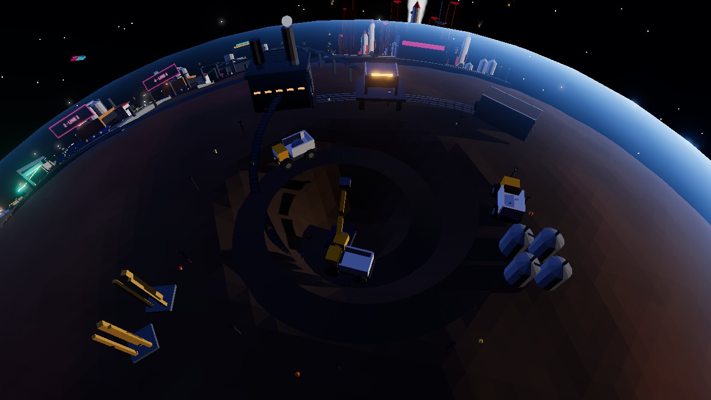

# DirectedByMultiBay

A living 3D globe, **Kepler-22b**, covered by a cyberpunk factory that visualizes real GitHub Actions builds and releases across multiple repositories. Farms and mines feed the build lines, trucks carry finished boxes to the rocket port, and a neon night market never sleeps. The world is always moving: nothing pops in or out, and the scene keeps looping even when no build is running.

Live site: https://christo-albuquerque.github.io/directed-by-multibay/

| | |
| --- | --- |
|  |  |
| **The planet:** a fixed master plan. Every district exists from the start; repos only relabel lines. | **Night market:** stalls, diners, towers and strollers, with hover traffic and drones overhead. |
|  |  |
| **Build line:** crates enter hidden housings at each station, so nothing appears from thin air. | **Rocket port:** one rocket leaves out of sight while another returns from a delivery and takes its place. |
|  |  |
| **Farms:** seed, grow, harvest, replant, forever. | **Mines:** carts go out full and come back empty. |

The full design lives in [SPEC.md](SPEC.md). Everything is generated in code: no third-party models, textures, fonts or audio. Dependencies must be permissive-licensed (checked in CI).

## Using it

- **Live data:** the page polls GitHub Actions for your repos and turns every run into a product on the belt. Click a
  product (or a run in the top-left list) to see where it is and every step.
- **Several repos, one planet:** each repo gets its own build line, pad, rescue crew and workers. Add or remove repos
  with **📂 Repos** (up to 6); unused lines keep running ambient products. Your list is saved in this browser. You can also use
  `?repos=owner/a,owner/b` in the URL, or change the shipped default in `public/repos.json`.
- **Rate limit:** without a token GitHub allows 60 API requests an hour, so updates slow down. **🔑 Token** takes an
  optional read-only token (kept only in this browser, sent only to api.github.com) for 5000 an hour.
- **Demo Panel:** force every state without GitHub (pick the demo bay from the dropdown when there are several).
- **Accessibility and devices:** works on phones (drag, pinch, tap a product), arrow keys pan the view, panels are
  keyboard-operable, `Esc` closes run details, and a screen-reader status line reports the factory mood. **Motion:
  reduced** (also automatic with your OS setting) removes strobing lights and screen glitches. Big factories lower their
  own render quality if the frame rate drops.

## How runs map to the factory

| GitHub | Factory |
| --- | --- |
| Step/job names containing checkout, install, setup, cache | Dependencies (raw material crates) |
| lint, format, eslint | Lint gate |
| build, compile, bundle | Build press (the crate becomes a sealed box) |
| test, e2e, coverage | Testing grounds: lifted, dropped, shot by a cannon, squashed |
| release, deploy, publish, upload | Dispatch: truck, crane, then the launchpad |
| success | Green seal, then a rocket (or a courier drone for `pull_request` runs) lifts off |
| failure at a step | Smoke, sparks and a rescue crew at that step's stage |
| cancelled | The product stops, then slides into the scrap chute |

Not built (yet): storms after repeated failures, and matrix builds fanning out into parallel lanes (their jobs share one lane).
- The demo project whose runs feed the default bay is [multibay-testlot](https://github.com/christo-albuquerque/multibay-testlot).

## Develop

```bash
npm install
npm run dev
```

## License

MIT. See [LICENSE](LICENSE).
